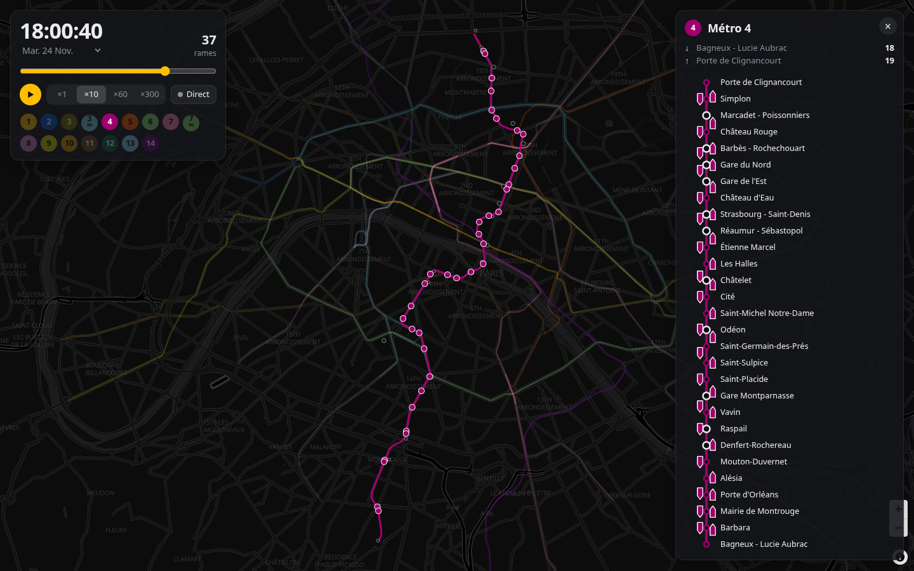
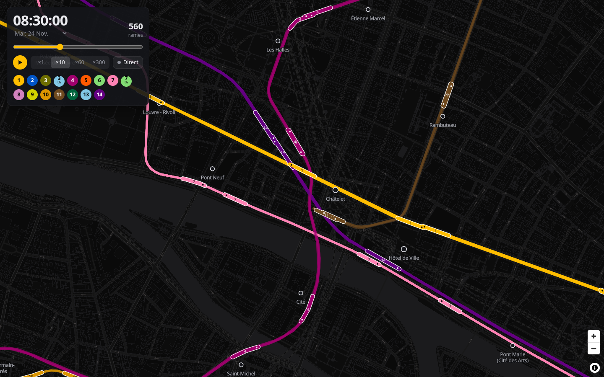

# Métro de Paris en mouvement

Carte animée de toutes les rames du métro parisien (lignes 1 à 14, 3bis et 7bis), reconstruite à partir des horaires officiels publiés en open data par Île-de-France Mobilités.


- **Toutes les rames** positionnées sur le tracé réel des lignes, avec accélération au départ et freinage à l'approche des stations. En zoomant, chaque rame est dessinée à l'échelle (75 m, 90 m sur les lignes 1 et 4, 120 m sur la 14) et épouse les courbes de la voie.
- **Le temps** : lecture, pause, vitesses ×1 à ×300, curseur sur la journée, choix du jour.
- **Le direct** : le bouton « Direct » cale la carte sur l'heure de Paris et, avec une clé API PRIM, place les rames d'après les prochains passages annoncés en temps réel.
- **Les lignes** : un clic sur une pastille ou sur un tracé isole la ligne et ouvre son schéma, avec ses stations, ses branches et toutes ses rames en mouvement dans les deux sens.
- **Les stations** : un clic affiche les prochains passages avec heure d'arrivée, heure de départ et direction.
- **Les rames** : un clic affiche la mission (arrêt en cours, arrêts à venir, horaires) ; « Suivre » garde la rame au centre.





Hors mode direct, les positions sont **théoriques** : elles découlent des horaires planifiés (GTFS).

## Temps réel

Le métro ne publie pas de position GPS. L'API [PRIM](https://prim.iledefrance-mobilites.fr/) d'Île-de-France Mobilités (`estimated-timetable`, format SIRI Lite) annonce, pour chaque arrêt, l'heure de passage des prochains trains vers chaque destination.

Sur la plupart des lignes, une « mission » du flux n'est pas une rame : le même identifiant porte des prévisions aux deux bouts de la ligne. Les rames sont donc reconstruites à partir des prévisions par arrêt (`src/realtime.ts`) :

1. chaque prévision « un train vers D arrive à l'arrêt S dans L secondes » est reportée le long de la marche théorique vers D : la rame est là où serait un train planifié L secondes avant S ;
2. les prévisions qui tombent au même endroit, à une tolérance près, décrivent la même rame vue depuis plusieurs arrêts ; celle de l'arrêt le plus proche fait foi ;
3. entre deux mises à jour (une par minute), la rame continue d'avancer selon la marche théorique.

Sur une capture du 22 novembre 2026 à 20 h 52, cette méthode donne 220 rames sur les 15 lignes couvertes, pour 197 prévues à l'horaire (ligne 14 : 24/24, ligne 9 : 19/19, ligne 10 : 6/6). Les lignes absentes du flux (la 6 ce jour-là) restent affichées d'après l'horaire, en transparence.

Pour l'activer :

1. créer un compte gratuit sur PRIM et générer un jeton API ;
2. cliquer sur « Direct » et coller la clé. Elle reste dans le navigateur (`localStorage`) et n'est envoyée qu'à PRIM, dans l'en-tête `apikey`.

Un jeton est limité à 1 000 requêtes par jour ; le flux est interrogé une fois par minute (environ 16 h de direct). La réponse couvre toute l'Île-de-France (30 Mo de JSON, 2,6 Mo compressés) : elle est lue et filtrée dans un worker pour ne pas figer la carte.

Pour servir le temps réel à tous les visiteurs sans clé, définir `VITE_REALTIME_URL` au build vers un proxy qui ajoute la clé côté serveur et renvoie la même réponse SIRI.

### La clé ne doit jamais être publiée

- En local, la clé se range dans `.env` (`PRIM_API_KEY=…`), ignoré par Git et jamais inclus dans le site construit.
- `npm install` active un crochet `pre-commit` (`.githooks/`) qui refuse tout commit contenant la valeur de cette clé ou un fichier `.env`.
- Ne jamais placer la clé dans une variable `VITE_…` : Vite l'écrirait dans le JavaScript publié.

## Lancer en local

Prérequis : Node.js 22+, Python 3.10+ (bibliothèque standard uniquement).

```bash
npm install
npm run data   # télécharge le GTFS IDFM (~110 Mo) et génère public/data/*.json (~30 s)
npm run dev
```

Pour réutiliser une archive déjà téléchargée :

```bash
python3 scripts/build_data.py --gtfs chemin/vers/IDFM-gtfs.zip
```

### Lien direct vers un instant

`?date=20261124&time=08:30&speed=60&paused` fixe le jour, l'heure, la vitesse et met en pause. `?line=4` ouvre une ligne (`3bis`, `7bis` acceptés), `?live` démarre en direct. La position de la carte est conservée dans le fragment d'URL (`#zoom/lat/lon`).

## Fonctionnement

```
IDFM GTFS (zip) ──► scripts/build_data.py ──► public/data/network.json    lignes, tracés, stations
                                          └─► public/data/timetable.json  missions, services, calendrier
                                                        │
                                                        ▼
                         src/schedule.ts   rames actives à l'instant t, tableaux de passages
                         src/realtime.ts   rames reconstruites depuis le flux PRIM (siri.ts, rt-worker.ts)
                         src/lineview.ts   schéma d'une ligne et de ses rames
                         src/geo.ts        position le long du tracé
                         src/main.ts       carte MapLibre, animation, interface
```

- **Extraction** : seules les lignes `route_type = 1` (métro) sont conservées. Les trajets partageant le même enchaînement d'arrêts et les mêmes temps de parcours sont regroupés en *missions* : ~34 000 trajets tiennent en ~420 missions, soit moins de 1 Mo de JSON.
- **Placement des arrêts** : chaque arrêt est projeté sur le tracé (`shapes.txt`) par programmation dynamique, ce qui respecte l'ordre des arrêts même sur les boucles (7bis, 10).
- **Journée de service** : les trajets d'après minuit (horaires GTFS ≥ 24:00) de la veille sont rattachés au jour affiché.

## Tests

```bash
npx playwright install chromium
npx playwright test
```

Les tests de bout en bout chargent l'application dans Chromium à des instants fixés (heure de pointe, après minuit) et vérifient le nombre de rames, les tableaux de passages, le clic sur une rame, l'animation, la vue par ligne (y compris une ligne à branches) et la longueur des rames dessinées. Les captures sont enregistrées dans `test-results/` (rapport : `npx playwright show-report`).

Le mode direct est testé sans appeler PRIM : contre un flux simulé à partir des horaires (2 minutes de retard), contre une clé refusée, et contre une capture réelle du flux (`tests/fixtures/`, partie métro uniquement, données IDFM sous licence ODbL).

## Déploiement

Le workflow GitHub Actions régénère les données chaque matin depuis le flux IDFM, exécute les tests puis publie le site sur GitHub Pages.

## Pistes

- Proxy partagé (Cloudflare Worker ou équivalent) pour le temps réel sans clé côté visiteur.
- RER, tramways et Transilien (même pipeline, autres `route_type`).
- Perturbations et info trafic PRIM sur la vue par ligne.

## Données et licences

- Code : [MIT](LICENSE).
- Horaires et tracés : [Île-de-France Mobilités — Horaires prévus sur les lignes de transport en commun (GTFS)](https://data.iledefrance-mobilites.fr/explore/dataset/offre-horaires-tc-gtfs-idfm/), licence ODbL. Les fichiers générés dans `public/data/` sont des bases dérivées soumises à la même licence ; ils ne sont pas versionnés.
- Fond de carte : [OpenFreeMap](https://openfreemap.org/), © OpenMapTiles, données © contributeurs OpenStreetMap.
