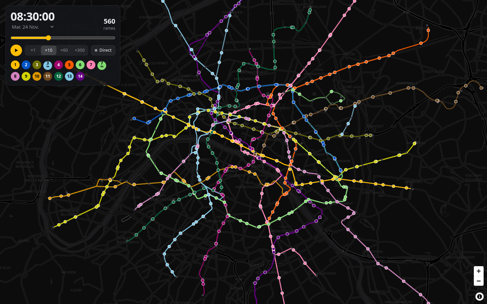

# Métro de Paris en mouvement

Carte animée de toutes les rames du métro parisien (lignes 1 à 14, 3bis et 7bis), reconstruite à partir des horaires officiels publiés en open data par Île-de-France Mobilités.



- **Toutes les rames** positionnées sur le tracé réel des lignes, avec accélération au départ et freinage à l'approche des stations.
- **Le temps** : lecture, pause, vitesses ×1 à ×300, curseur sur la journée, choix du jour.
- **Les stations** : un clic affiche les prochains passages avec heure d'arrivée, heure de départ et direction.
- **Les rames** : un clic affiche la mission complète (arrêts franchis, arrêt en cours, horaires) ; « Suivre » garde la rame au centre.
- **Les lignes** : un clic sur une pastille masque la ligne ; Maj + clic l'isole.
- **Le direct** : le bouton « Direct » cale la carte sur l'heure de Paris et, avec une clé API PRIM, place les rames d'après les prochains passages prévus en temps réel.

Hors mode direct, les positions sont **théoriques** : elles découlent des horaires planifiés (GTFS).

## Temps réel

Le métro ne publie pas de position GPS. L'API [PRIM](https://prim.iledefrance-mobilites.fr/) d'Île-de-France Mobilités (`estimated-timetable`, format SIRI Lite) donne, pour chaque rame en circulation, l'heure d'arrivée et de départ prévue à ses prochains arrêts. La position est interpolée entre l'arrêt précédent et le suivant, le long du tracé GTFS.

1. Créer un compte gratuit sur PRIM et générer un jeton API.
2. Cliquer sur « Direct » et coller la clé. Elle reste dans le navigateur (`localStorage`) et n'est envoyée qu'à PRIM, dans l'en-tête `apikey`.

Le flux est interrogé une fois par minute (rythme de mise à jour de PRIM ; un jeton récent est limité à environ 1 000 requêtes par jour). Les lignes absentes du flux restent affichées d'après l'horaire théorique, en transparence.

Pour servir le temps réel à tous les visiteurs sans clé, définir `VITE_REALTIME_URL` au build vers un proxy qui ajoute la clé côté serveur et renvoie la même réponse SIRI.

## Lancer en local

Prérequis : Node.js 22+, Python 3.10+ (bibliothèque standard uniquement).

```bash
npm install
npm run data   # télécharge le GTFS IDFM (~110 Mo) et génère public/data/*.json (~30 s)
npm run dev
```

Pour réutiliser une archive déjà téléchargée :

```bash
python3 scripts/build_data.py --gtfs chemin/vers/IDFM-gtfs.zip
```

### Lien direct vers un instant

`?date=20261124&time=08:30&speed=60&paused` fixe le jour, l'heure, la vitesse et met en pause. La position de la carte est conservée dans le fragment d'URL (`#zoom/lat/lon`).

## Fonctionnement

```
IDFM GTFS (zip) ──► scripts/build_data.py ──► public/data/network.json    lignes, tracés, stations
                                          └─► public/data/timetable.json  missions, services, calendrier
                                                        │
                                                        ▼
                         src/schedule.ts   rames actives à l'instant t, tableaux de passages
                         src/realtime.ts   flux PRIM SIRI, position des rames en direct
                         src/geo.ts        position le long du tracé
                         src/main.ts       carte MapLibre, animation, interface
```

- **Extraction** : seules les lignes `route_type = 1` (métro) sont conservées. Les trajets partageant le même enchaînement d'arrêts et les mêmes temps de parcours sont regroupés en *missions* : ~34 000 trajets tiennent en ~420 missions, soit moins de 1 Mo de JSON.
- **Placement des arrêts** : chaque arrêt est projeté sur le tracé (`shapes.txt`) par programmation dynamique, ce qui respecte l'ordre des arrêts même sur les boucles (7bis, 10).
- **Journée de service** : les trajets d'après minuit (horaires GTFS ≥ 24:00) de la veille sont rattachés au jour affiché.

## Tests

```bash
npx playwright install chromium
npx playwright test
```

Les tests de bout en bout chargent l'application dans Chromium à des instants fixés (heure de pointe, après minuit), vérifient le nombre de rames, les tableaux de passages, le clic sur une rame, l'animation et les filtres de ligne, et enregistrent des captures dans `test-results/` (rapport : `npx playwright show-report`). Le mode direct est testé contre une réponse PRIM simulée, construite à partir des horaires avec un retard de 2 minutes, ainsi que contre une clé refusée.

## Déploiement

Le workflow GitHub Actions régénère les données chaque matin depuis le flux IDFM, exécute les tests puis publie le site sur GitHub Pages.

## Pistes

- Proxy partagé (Cloudflare Worker ou équivalent) pour le temps réel sans clé côté visiteur.
- RER, tramways et Transilien (même pipeline, autres `route_type`).
- Rames orientées selon le sens de marche.

## Données et licences

- Code : [MIT](LICENSE).
- Horaires et tracés : [Île-de-France Mobilités — Horaires prévus sur les lignes de transport en commun (GTFS)](https://data.iledefrance-mobilites.fr/explore/dataset/offre-horaires-tc-gtfs-idfm/), licence ODbL. Les fichiers générés dans `public/data/` sont des bases dérivées soumises à la même licence ; ils ne sont pas versionnés.
- Fond de carte : [OpenFreeMap](https://openfreemap.org/), © OpenMapTiles, données © contributeurs OpenStreetMap.
